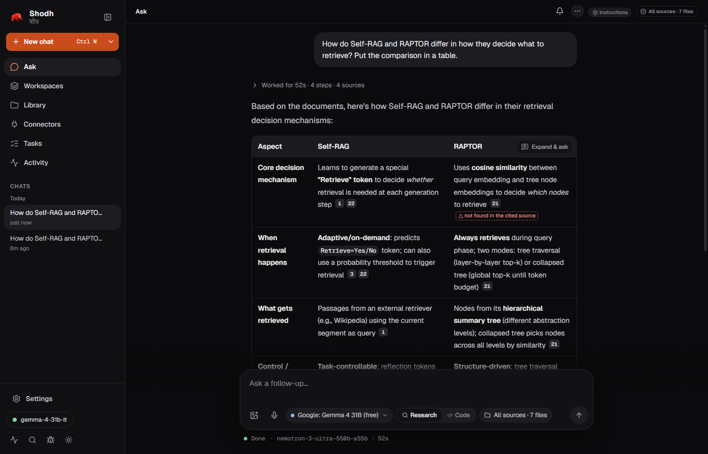
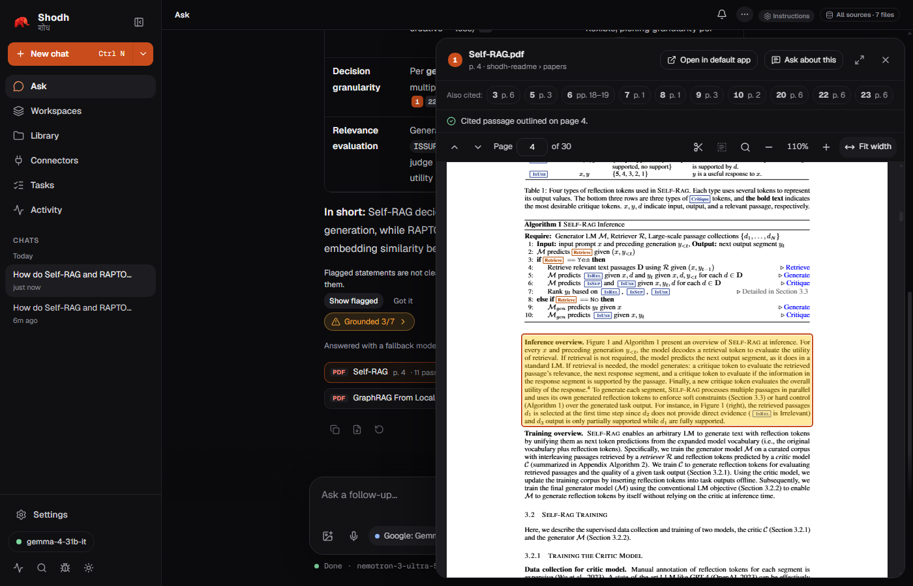

<p align="center">
  <picture>
    <source media="(prefers-color-scheme: dark)" srcset="docs/assets/banner-dark.svg" />
    <source media="(prefers-color-scheme: light)" srcset="docs/assets/banner-light.svg" />
    
  </picture>
</p>

<p align="center">
  <strong>An open-source, local-first alternative to NotebookLM for your research papers and folders.<br />Every answer is cited to the exact page, and every cited statement is checked against its source.</strong>
</p>

<p align="center">
  <a href="https://github.com/varun29ankuS/shodhRAG/releases/latest"></a>
  <a href="https://github.com/varun29ankuS/shodhRAG/actions/workflows/ci.yml?query=branch%3Amaster"></a>
  <a href="LICENSE"></a>
  <a href="https://github.com/varun29ankuS/shodhRAG/releases"></a>
</p>

<p align="center">
  <a href="https://github.com/varun29ankuS/shodhRAG/releases/latest/download/Shodh_x64-setup.exe"><strong>Download for Windows</strong></a> &middot;
  <a href="https://github.com/varun29ankuS/shodhRAG/releases/latest/download/Shodh_aarch64.dmg"><strong>Download for macOS (Apple silicon)</strong></a> &middot;
  <a href="https://github.com/varun29ankuS/shodhRAG/releases/latest">All downloads</a> &middot;
  <a href="https://varun29ankus.github.io/shodhRAG/">Website</a>
</p>

---

**Shodh** (Sanskrit: शोध, "research") is a desktop app for researchers and teams. Point it at your folders and ask questions about them. Your documents are parsed, OCR'd, indexed and embedded on your computer; answers come from the language model you choose, running locally (Ollama or LM Studio) or in the cloud with your own key or subscription.

https://github.com/user-attachments/assets/16719eb6-af1b-49a0-8adf-8ee3b34b4fe1

## What it does

- **Answers cited to the page.** Click a citation and the PDF opens at the cited page with the passage outlined.
- **Checked citations.** Each cited statement is checked on your computer against its passage, with no language model judging; unsupported statements are flagged inline.
- **Folders that stay in sync.** PDF, Word, PowerPoint, spreadsheets, Markdown, LaTeX, HTML, e-books, emails and code; scanned pages and images are read with OCR.
- **Built for papers.** A graph of how your papers cite each other, and numeric results compared across papers, every value cited.
- **Workspaces, memory and tasks.** Each workspace has its own sources and instructions; Shodh remembers what you ask it to, and keeps your tasks and calendar.
- **Your model, your choice.** Local models, or OpenRouter, Anthropic, OpenAI, Google Gemini and xAI with your key, or a Claude, ChatGPT, Copilot or Gemini subscription.
- **Open source.** Apache-2.0, with a Rust core you can use as a library.

The full list, by area, is in [docs/FEATURES.md](docs/FEATURES.md).

<p align="center"></p>
<p align="center"></p>

<sub>The screenshots show open-access papers (CC BY 4.0, from arXiv): Self-RAG, RAPTOR, GraphRAG, the Faiss library, E5 text embeddings and best practices in RAG.</sub>

## Download

| System | File |
|---|---|
| Windows 10 or 11, 64-bit | [`Shodh_x64-setup.exe`](https://github.com/varun29ankuS/shodhRAG/releases/latest/download/Shodh_x64-setup.exe) |
| macOS 13.3 or later on Apple silicon (no Intel build) | [`Shodh_aarch64.dmg`](https://github.com/varun29ankuS/shodhRAG/releases/latest/download/Shodh_aarch64.dmg) |
| Android 7 or later, 64-bit (pairs with Shodh on your computer) | [`Shodh_android.apk`](https://github.com/varun29ankuS/shodhRAG/releases/latest/download/Shodh_android.apk) |

Each [release](https://github.com/varun29ankuS/shodhRAG/releases/latest) also lists every file under its versioned name, with SHA-256 checksums.

The installers are not code-signed yet, so the system warns you before the first launch:

- **Windows:** SmartScreen shows "Windows protected your PC". Click **More info**, then **Run anyway**.
- **macOS:** drag Shodh into Applications and open it once; macOS refuses it. Then:
  - **macOS 15 (Sequoia) and later:** open **System Settings → Privacy & Security** and click **Open Anyway** next to the message about Shodh.
  - **macOS 14 (Sonoma) and earlier:** Control-click (or right-click) Shodh in Applications, choose **Open**, then **Open** again.
  - If macOS says the app "is damaged", run `xattr -dr com.apple.quarantine /Applications/Shodh.app` in Terminal and open it again.

Shodh checks for updates once a day and installs one only when you choose to. Updates are signed, and one whose signature does not verify is refused.

## Quick start

1. Install and open Shodh.
2. Click **Set up search**. Shodh downloads its search and OCR models (about 650 MB) once and checks each file's SHA-256. When asked, also click **Install agent runtime** (a one-time download from GitHub).
3. Choose a model in **Settings → Models**: a local one (Ollama or LM Studio), an API key, or a subscription sign-in.
4. In the Library, click **Add folder** and pick a folder of papers or documents.
5. Ask a question in **Ask**, then click a citation to see the passage.

## Privacy

- **Your documents** (their text, OCR results and embeddings) stay on your computer. Indexing makes no network calls.
- **Your questions, and the passages retrieved to answer them,** go to the model provider you choose, with workspace instructions and any memories recalled for that answer. With a local model and web access off, they stay on your computer.
- **Other connections** happen only for features you use: web search, paper lookups, model downloads, the update check, and the Slack, Telegram, GitHub and phone connections once you set them up. With a cloud provider, the agent runtime has also been observed fetching public model metadata from its catalog.
- **Local-only mode** (**Settings → Privacy**) turns off web tools, cloud models and the update check.

Every outbound connection, and the known gaps (such as unencrypted storage), are listed in [Data and privacy](docs/FEATURES.md#data-and-privacy-what-leaves-your-computer) and [Known limitations](docs/FEATURES.md#known-limitations).

## Build from source

You need Rust (stable), Node.js 22 or later, and your platform's build tools. Then:

```bash
git clone https://github.com/varun29ankuS/shodhRAG.git
cd shodhRAG/app
npm ci
npm run tauri build
```

Development setup, model locations, environment variables and the core library's API are in [Building from source](docs/FEATURES.md#building-from-source) and [Configuration](docs/FEATURES.md#configuration).

## Contributing

1. **Branch and PR:** create a feature branch from `master`, open a PR, and merge only when CI is green.
2. **Production code only:** no TODOs, mocks, stubs or placeholders.
3. **Fix root causes:** never weaken a check to make CI pass.
4. **Keep PRs focused**, and explain *why* in commit messages.

Run these before opening a PR (CI runs the same checks, plus the tests and the retrieval eval):

```bash
cargo fmt --all --check
cargo clippy --workspace -- -D clippy::correctness -D clippy::suspicious -D clippy::perf
(cd app && npx tsc --noEmit && npm test)
```

## License

[Apache License 2.0](LICENSE). Copyright 2025 Shodh.
