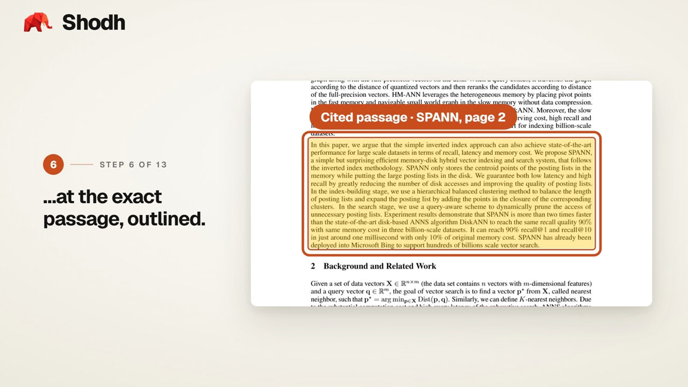

<p align="center">
  
</p>

<h1 align="center">Shodh</h1>

<p align="center">
  <strong>Ask questions across your papers and folders and get answers cited to the exact page. Your documents stay on your computer.</strong>
</p>

<p align="center">
  <a href="#watch-the-2-minute-tour">Tour</a> &middot;
  <a href="#download">Download</a> &middot;
  <a href="#pricing">Pricing</a> &middot;
  <a href="#what-works-today">What works today</a> &middot;
  <a href="#retrieval-quality">Retrieval quality</a> &middot;
  <a href="#in-progress">In progress</a> &middot;
  <a href="#quickstart">Quickstart</a> &middot;
  <a href="#data-and-privacy">Data &amp; privacy</a> &middot;
  <a href="#architecture">Architecture</a> &middot;
  <a href="#contributing">Contributing</a>
</p>

<p align="center">
  <a href="https://github.com/varun29ankuS/shodhRAG/blob/master/LICENSE"></a>
  
  
  
</p>

---

**Shodh** (Sanskrit: शोध, "research") is a desktop app for researchers and teams. It reads the folders you point it at and answers questions about them. Each answer cites the file and page it came from, and each cited statement is checked against its source.

- **Processing:** your documents are parsed, OCR'd, indexed and embedded on your computer.
- **Answers:** these come from the language model you choose. That can be a model running locally (Ollama or LM Studio), or a cloud provider using your own API key or subscription.

## Watch the 2-minute tour



<!-- TOUR-VIDEO: paste the GitHub video link on the next line -->
https://github.com/user-attachments/assets/16719eb6-af1b-49a0-8adf-8ee3b34b4fe1

> **Status: pre-release.** The latest release is 0.0.4. This README describes the `master` branch, so some items below are newer than the latest installers and arrive with the next release. What does not work yet is listed under [In progress](#in-progress).

## Download

Get the latest installer from [Releases](https://github.com/varun29ankuS/shodhRAG/releases/latest):

- **Windows 10 or 11, 64-bit:** `Shodh_<version>_x64-setup.exe`
- **macOS 13.3 or later on Apple Silicon:** `Shodh_<version>_aarch64.dmg`. There is no Intel Mac build.

The installers are not code-signed yet, so the system warns you before the first launch:

- **Windows:** SmartScreen shows "Windows protected your PC". Click **More info**, then **Run anyway**.
- **macOS:** drag Shodh into Applications and open it once; macOS refuses it. Then:
  - **macOS 15 (Sequoia) and later:** open **System Settings → Privacy & Security** and click **Open Anyway** next to the message about Shodh.
  - **macOS 14 (Sonoma) and earlier:** Control-click (or right-click) Shodh in Applications, choose **Open**, then **Open** again.
  - If macOS says the app "is damaged", run `xattr -dr com.apple.quarantine /Applications/Shodh.app` in Terminal and open it again.

The release notes on each release give the same steps in more detail.

Shodh checks for updates a few minutes after start and then once a day. An update is downloaded and installed only when you choose to. Updates are signed, and one whose signature does not verify is refused. You can turn the check off in **Settings → Privacy**, and it never runs in Local-only mode.

## Pricing

The core of Shodh is free and open source (Apache-2.0), and it stays that way. Pro and Team plans will come later.

## What works today

**Ask your files**
- Answers stream in with numbered citations. Click a citation to open the source at the cited passage.
- The question goes to an agent that searches your library, opens documents and, when allowed, searches the web. Each step is shown as it runs, for example "8 passages from 3 files · 1.2s". A finished answer folds them into one line, such as "Worked for 12s · 5 steps · 3 sources".
- **Stop** (or Esc) cancels the run.
- **Visuals:** answers can include diagrams, charts, timelines and tables, and the model is asked to lead with one when it fits the question. Marked parts of an answer offer **Go deeper**, which asks a prepared follow-up in a side pane only when you click it.
- **Reasoning:** **Think before answering** (**Settings → Search**, off by default) lets the model reason first. When a model streams its reasoning, a **Reasoning** button under the answer shows it.
- **Ask about this:** select text in an answer or a document and click **Ask about this** (Ctrl+Shift+A). This opens a side discussion that keeps the parent answer's passages under the same numbers. It can post a summary back to the main conversation, with its citations written out as "(side-discussion source: file, p. N)".
- **Long chats:** conversations render only the messages on screen. **Ctrl+F** (Cmd+F on macOS) finds text in the whole conversation.
- **Saving:** a finished answer is saved as soon as it is final, and pending saves are written before the app quits. If the app is killed while an answer is being checked, the answer comes back marked as not checked.
- **Drafts:** each conversation keeps its unsent question while you switch views, for the session.
- **Images:** text read from a pasted or dropped image is attached to your next question as a removable chip. It goes to the model next to your question, not as part of it.

**Citation check**
- Every answer is checked on this computer, statement by statement, against the passages it cites. No language model judges the answer.
- The cross-encoder reranker scores each statement against its passage, together with number and quote checks. A quote of four or more words must appear in the cited text word for word.
- **Answer checking model:** an optional local model, about 96 MB, installed from **Settings → Search**.
- Unsupported statements are flagged inline, for example "not found in the cited source" or "source [n] does not exist". A chip shows the score, such as "Grounded 4/5".
- When another passage of the same answer supports a flagged statement, the flag offers **Cite N instead**. The correction is recorded in Activity first; if it cannot be recorded, nothing is changed. A corrected citation is marked "citation corrected by you".
- Flagged citations are not passed on when an answer becomes context for a follow-up or a side discussion.
- **Re-check flagged statements** (on by default) asks the model once to cite the right passage, correct the statement or remove it. If the model cited passages without searching, Shodh runs the search itself first.

**Model errors**
- When the provider fails, the answer ends as an error, not as an answer. Any partial text is kept and marked Incomplete.
- The error card says what happened in plain words (for example a timeout, a rejected key or a rate limit), with a **Retry** button and **Details from the provider**. Keys and tokens are masked in those details.

**Document viewer**
- **PDFs** open at the cited page with the passage outlined and scrolled into view.
- **Word, PowerPoint, Markdown, HTML, text and code** open as extracted text with the passage highlighted.
- **Spreadsheets and CSV** open as a grid.
- The model, the citation check and the viewer see the same passage text, and it always contains the part that search matched.

**Library and folders**
- **Folder sync:** add a folder in the Library (**Add folder**) and it stays in sync:
  - A file watcher picks up new, changed and deleted files.
  - Changes made while the app was closed are caught on the next start.
  - An interrupted sync resumes where it stopped.
  - A rename is handled as a removal plus a new file.
- **Files already indexed:** adding a folder takes over its unchanged, already indexed files instead of reading them again. Indexed files that are in no listed folder are shown in the Library, with **Add these folders**.
- **Names:** files and folders are shown in their case on disk.
- **Removing a source** removes only that source, not a folder whose path merely starts the same way. The removal is recorded first, holds across a restart, and stops that source's sync or indexing.
- **Unreadable folders:** if a subfolder cannot be read, its files are kept and the card shows a sync error.
- **Failures:** the Library lists each file that could not be indexed, grouped by a plain reason, for example "Protected with a password", "Damaged or incomplete" or "This file type is not supported".
- **One-time upgrade:** existing libraries are re-chunked once with the current parser. The card shows "Updating index for improved text extraction" while it runs, and files that failed before are tried once more.

**Documents**
- **Text documents:** PDF, Word (`.docx`), PowerPoint (`.pptx`), Markdown, LaTeX, HTML (`.html`, `.htm`), plain text and source code.
  - PDFs are parsed with their layout: headings, paragraphs, lists, tables and footnotes. A PDF's printed title becomes the document title, so a file named `1706.03762v7.pdf` is found by its title.
  - Word and PowerPoint text is read with an XML parser, so XML markup is not indexed and entities such as `&amp;` are decoded. Word tables become table sections.
  - Text in any script is chunked, including Chinese, Japanese, Devanagari, Cyrillic and Arabic.
  - HTML pages in any script are read without scripts, styles or comments, and their entities are decoded.
  - PDF, scan, LaTeX and Markdown chunks are sized in tokens and never cross a heading.
- **Tables in PDFs:** an optional table-structure model (Windows, about 212 MB, **Settings → Search**) re-reads table pages in the background.
- **Spreadsheets:** `.xlsx`, `.xls`, `.xlsm`, `.xlsb`, `.ods`, plus CSV and TSV. Sheets are indexed row by row, and every chunk repeats the header row.
- **Size limits:** text files up to 50 MB, spreadsheets and Office files up to 100 MB, PDFs up to 2,000 pages. A larger file is reported as "too large to index" and is not read.

**Scanned documents**
- Scanned PDF pages and images (PNG, JPEG, BMP, TIFF) are read with PP-OCRv6. The OCR model is installed with the search models.
- OCR runs in a child process at below-normal priority on half the cores, so the computer stays responsive. Progress reads "Reading scanned pages: 12 of 240".
- OCR results are cached per file, so an unchanged scan is not read twice.
- When OCR cannot read some pages, it keeps the rest and names the pages it missed. When it reads nothing, it says why.
- On Windows, Windows OCR is the fallback while the PP-OCRv6 model is missing. macOS uses PP-OCRv6 only.

**Retrieval**
- **Hybrid search:** dense vectors (multilingual E5, ONNX, on device) and BM25 keyword search (Tantivy), fused with reciprocal rank fusion.
- **Reranking:** a cross-encoder reorders the results.
- **Papers:** the Library's paper graph shows how your papers cite each other, read from their bibliographies.
- **Compare results:** numeric results are read from the tables of papers. Every value is cited, and low-confidence values wait for your review.

**Workspaces**
- A workspace is a named set of sources (folders, files, snippets, papers) with instructions. Its chats search only those sources unless you ask for the whole library.
- Snippets and results made in the Library are visible to workspace chats, limited to that workspace's files.
- Instructions are versioned, with history.
- Templates: Blank, Literature review, Grant proposal, Paper writing, Client audit.
- Deleting a workspace keeps its memories, snippets, results, tasks and chats; they move out of the workspace.

**Memory**
- Start a message with "Remember …" (or "Keep in mind …", "From now on …") and Shodh files a note card for you to accept, without a model call.
- Shodh also suggests memories from your conversations, within a daily cap of model calls (10 by default). You accept or dismiss each one.
- **Settings → Memory** lists them, with search, edit, pin, history, export and forget. Forget removes a memory and all its earlier versions, and the audit log records it.

**Tasks and calendar**
- **Tasks** shows tasks and events as a list or a calendar, with reminders. A task can belong to a workspace, and each workspace has a task board.
- The **New** menu (beside New chat, or Ctrl/Cmd+Shift+N) creates a chat, workspace, task or event, or adds a folder, from any view.
- Tasks and events are indexed, so you can ask about them, and the assistant can create and update them.

**Notifications**
- Desktop notifications on Windows and macOS for reminders, approvals that wait for you, finished work (answers, indexing, extracted results) and problems (failed indexing or sync, a failed background model call, a data file that had to be recovered).
- They appear only while the Shodh window is not in front. They name titles and counts, never document or answer text.
- **Settings → Notifications** has a switch per category, **Send a test notification**, and **Open system notification settings**.

**Inbox and Activity**
- **Inbox** collects what waits on you, such as approvals, memory suggestions and reminders, and background work that finished or failed.
- **Activity** shows usage and the audit log of questions, tool calls, approvals, retrievals, answers and setting changes. The log can be filtered and exported (JSONL, CSV), and it has a retention setting. Retention deletes only events older than the window, even after the system clock jumps.
  - Each event is hash-chained to the one before it.
  - **Verify integrity** reports the first event that was edited, deleted or reordered.

**Assistant tools**
- The assistant runs on [oh-my-pi](https://github.com/can1357/oh-my-pi) (`omp`), a pinned agent runtime driven over RPC. See [ADR 0001](docs/adr/0001-agent-harness-omp.md).
  - **Install agent runtime** downloads it once from GitHub. Shodh checks its SHA-256 before every launch.
- Every tool runs in Rust and is permission-checked. Each answer has a budget of tool calls, and writes and deletions wait for your approval.
- **Built-in tools:** library search and documents, web search and pages, paper search, tasks and calendar, memory, workspaces, conversations, settings and exports.
- **More tools:** add MCP servers and skills in **Settings → Tools & connections**.
- **Code mode:** the **Research | Code** switch in Ask lets a conversation read, change and run commands in a workspace's code folder.
  - File tools are confined to that folder. Shell commands cannot be confined by path, so each one needs approval unless you allow it.
  - In a git repository, changes go on a branch of their own and can be discarded.

**Models**
- **Cloud with your API key:** OpenRouter, Anthropic, OpenAI, Google Gemini and xAI.
- **Cloud with a subscription:** sign in with Claude Pro/Max, ChatGPT Plus/Pro, GitHub Copilot or Google Gemini.
- **Local:** Ollama or LM Studio. The assistant needs tool calling, so GGUF files loaded in-process cannot answer questions.
- **Pre-configuration:** set the model with environment variables, so IT can lock in the approved provider on managed machines. See [Configuration](#configuration).

**Privacy controls and app**
- **Local-only mode** (**Settings → Privacy**) keeps everything on this computer: no web tools, no cloud models and no update check.
- **Web access:** the assistant's web access can be turned off on its own.
- **API keys** are kept in the OS credential store. A removed key is never sent again: answers running on it stop and say so.
- **Crash-safe data:** conversations, settings, the calendar and app state are written through a temporary file, keeping the previous version as a backup. A damaged file falls back to its backup and is set aside, never overwritten.
- **Background:** Shodh can keep running in the tray and start when you log in (**Settings → General**). On macOS, clicking the Dock icon brings the window back.

## Retrieval quality

[`crates/shodh-eval`](crates/shodh-eval) measures retrieval on the app's real indexing and search code, with no language model involved. The **Retrieval eval** CI job re-indexes both committed sets on every PR. Retrieval is deterministic, so the job fails on any drop below the committed baseline.

| Set | What it is | Questions |
|---|---|---|
| Synthetic | Fictional contracts and invoices (paged PDFs with tables), research notes and policies | 50, 5 of them unanswerable |
| Scanned | Pages of those contracts and invoices as image-only scans, plus text distractors, read with PP-OCRv6 | 34, 5 of them unanswerable |

Baselines ([synthetic](crates/shodh-eval/data/synthetic/baseline.json), [scanned](crates/shodh-eval/data/scanned/baseline.json); recorded 2026-10-11, top 10, reranking on):

| Metric | Synthetic | Scanned |
|---|---|---|
| hit@1 (right document first) | 0.978 | 1.000 |
| MRR | 0.989 | 1.000 |
| page_hit@1 (right page first) | 0.939 | 1.000 |
| passage_hit@1 (chunk holding the expected passage first) | 0.947 | 1.000 |
| hit, page_hit and passage_hit @5 and @10 | 1.000 | 1.000 |
| Files indexed | 1.000 | 1.000 |

These are small fictional sets. They catch regressions; they do not predict quality on your documents. Answer quality (`shodh-eval answers`) needs a language model, so it does not run in CI, and no baseline has been published yet.

## In progress

Nothing below works yet.

| Area | What it brings |
|---|---|
| **Server mode** | The same core running headless, with SSO and per-document permissions enforced inside every query. |
| **Encryption at rest** | Encryption of the local index (LanceDB, Tantivy). The app database can already use SQLCipher, but only as a build option that released builds do not use. |
| **Records and totals** | Typed records (invoices, spreadsheet rows), with totals and counts computed in code. |
| **Knowledge graph beyond papers** | Entities and relations from any document, each with page-level provenance. |
| **Sub-agents** | Restricted child sessions, shown as live lanes. See [ADR 0001](docs/adr/0001-agent-harness-omp.md). |
| **Structure-aware chunks for every format** | Word, PowerPoint, HTML and plain text still use sliding windows. |
| **Answer-quality baseline** | Published answer metrics for the committed sets. |
| **Code signing** | Signed installers for Windows and macOS. |

## Quickstart

### Prerequisites

- [Rust](https://rustup.rs/) (stable) and [Node.js](https://nodejs.org/) 22 or later.
- Platform build tools:
  - **Windows:** [Microsoft C++ Build Tools](https://visualstudio.microsoft.com/visual-cpp-build-tools/) and `protoc` (`choco install protoc`).
  - **macOS:** `xcode-select --install`
  - **Linux** (not built in CI): `sudo apt install build-essential libssl-dev libwebkit2gtk-4.1-dev protobuf-compiler`
- **Search models** (about 650 MB with the OCR model): on first run the app shows **Set up search** in Ask and Library and downloads the pinned, SHA-256-verified files itself.
  - Debug builds install them into `models/` at the root of the checkout; release builds use `<app data>/models`.
  - Setting `MODEL_PATH` overrides the location (and the install target).
  - Layout:
    - `models/multilingual-e5-base/`: `model_O4.onnx` and `tokenizer.json` from [intfloat/multilingual-e5-base](https://huggingface.co/intfloat/multilingual-e5-base/tree/main/onnx)
    - `models/ms-marco-MiniLM-L6-v2/`: `model_O4.onnx` and `tokenizer.json` from [cross-encoder/ms-marco-MiniLM-L6-v2](https://huggingface.co/cross-encoder/ms-marco-MiniLM-L6-v2)
    - `models/pp-ocrv6/`: the PP-OCRv6 small detection and recognition models
  - The answer checking model (`nli-deberta-v3-xsmall/`) and the table model (`docling-tables/`) are optional installs from **Settings → Search**.
- **Agent runtime:** installed from the app (**Install agent runtime**), or set `SHODH_OMP_PATH` to an `omp` binary.

### Run in development

```bash
git clone https://github.com/varun29ankuS/shodhRAG.git
cd shodhRAG/app
npm ci

# Terminal 1: frontend dev server
npx vite --port 5173 --strictPort

# Terminal 2: desktop app (reuses the dev server above)
npx tauri dev --config '{"build":{"beforeDevCommand":""}}'
```

On Windows PowerShell, pass the config as `--config "{\"build\":{\"beforeDevCommand\":\"\"}}"`.

The first build compiles the Rust workspace and takes several minutes. Later builds are incremental.

### Production build

```bash
cd app
npm run tauri build
```

## Configuration

### Choosing a model

Choose a model in **Settings → Models**, or pre-configure it with environment variables. The environment variables are ignored unless `SHODH_LLM_PROVIDER` is set.

| Variable | Values |
|---|---|
| `SHODH_LLM_PROVIDER` | `openrouter`, `anthropic`, `openai`, `google` (or `gemini`), `grok` (or `xai`), `ollama` |
| `SHODH_LLM_MODEL` | Provider model ID (optional), e.g. `anthropic/claude-haiku-4.5` |
| API key | The provider's usual variable: `OPENROUTER_API_KEY`, `ANTHROPIC_API_KEY`, `OPENAI_API_KEY`, `GEMINI_API_KEY` (or `GOOGLE_API_KEY`), `XAI_API_KEY` |

A key saved in the app is used before a key from an environment variable.

Local models:
- **Ollama:** run `ollama pull <model>`, then set `SHODH_LLM_PROVIDER=ollama` or pick it in **Settings → Models**.
- **LM Studio:** load a model in LM Studio and pick it under **Settings → Models → Run locally**.

### Separate profile (demo or testing)

Set `SHODH_DATA_DIR` to an absolute folder to run a separate profile:
- Its library, settings, chats and WebView storage live in that folder.
- Its saved API keys use a credential-store service of their own.
- It runs beside your normal instance instead of switching to it.
- It cannot change the start-with-Windows entry.

Search models are downloaded into that folder. To reuse an existing download, also set `MODEL_PATH` (installs then write there).

Run one instance per folder. WebView storage is separated on Windows, Linux and macOS 14+.

## Data and privacy

| Data | Where it goes |
|---|---|
| Your files, their text, OCR results and embeddings | Stay on this computer. Indexing makes no network calls. |
| Questions, and the passages retrieved to answer them | Sent to the model provider you choose, together with workspace instructions and any memories recalled for that answer. Memory suggestions are learned by sending your messages to that model. With a local model, and web access off (or Local-only mode on), questions and passages stay on this computer. |
| Web searches and pages | When web access is on, web searches go through OpenRouter's web plugin, Gemini with Google Search, or your SearXNG (`SHODH_SEARXNG_URL`), and pages are fetched directly. Off in Local-only mode. |
| Paper lookups | Building the paper graph online looks papers up on OpenAlex, only when you ask for it and the web is allowed. |
| Downloads | Models come from Hugging Face and the agent runtime from GitHub, each pinned and checked by SHA-256. The update check contacts GitHub once a day; it is off in Local-only mode, and you can turn it off yourself. |
| Agent runtime | With a cloud provider, the pinned runtime was also observed fetching public model metadata from its catalog (`catalog.stencil.so`). |
| Notifications | Desktop notifications carry titles and counts only, never document or answer text. |
| API keys | Stored in the OS credential store (Windows Credential Manager, macOS Keychain, Secret Service on Linux). They are never kept in the app's web storage or shown back in the UI. A key set through an environment variable applies to that session only. Subscription sign-ins are held by the agent runtime's own account store, in Shodh's app data folder. |
| Audit log | Kept in `shodh.db` on this computer. |

**Known gaps.**
- **Unencrypted storage:** released builds do not encrypt the local index (LanceDB, Tantivy) or the app database (`shodh.db`). Use OS full-disk encryption (BitLocker or FileVault).
- **Audit chain without a key:** the hash chain shows edited, deleted or reordered events. Someone who can write to `shodh.db` could still rebuild the whole chain.
- **Agent runtime egress:** the pinned runtime's catalog fetch cannot be turned off yet (see [ADR 0001](docs/adr/0001-agent-harness-omp.md)).
- **Code mode commands run as you:** approved shell commands run with your user account's permissions, without a sandbox.
- **No messaging channels or Google Drive sync:** the old WhatsApp, Telegram and Discord bot backends and the Google Drive connector have been removed. They ran unauthenticated local HTTP servers.

## Architecture

```
shodhRAG/
├── crates/
│   ├── shodh-rag/              # Core library
│   │   └── src/
│   │       ├── processing/     # Parsers (PDF layout, Office XML, spreadsheets, CSV/TSV), OCR, chunkers, size limits
│   │       ├── search/         # Tantivy BM25 and fusion
│   │       ├── storage/        # LanceDB store
│   │       ├── embeddings/     # E5 via ONNX Runtime, pinned model downloads
│   │       ├── reranking/      # Cross-encoder reranker
│   │       ├── harness/        # omp sidecar, host tools, citation check, provider errors, web, MCP, Code mode
│   │       ├── folder_sync.rs  # Folder manifests and sync
│   │       ├── research/       # Paper graph, paper results
│   │       ├── workspaces/     # Workspaces and templates
│   │       ├── user_memory/    # Memories and the learner
│   │       ├── audit/          # Hash-chained audit log
│   │       └── llm/            # Provider settings and local providers
│   ├── shodh-ontology/         # Typed statements behind memories, snippets and results
│   └── shodh-eval/             # Retrieval and answer evaluation
├── app/
│   ├── src/                    # React 19 + TypeScript frontend
│   │   ├── components/shell    # Sidebar, Settings
│   │   └── features/           # ask, agent, focus (side discussions), library, workspaces, tasks,
│   │                           # activity, audit, inbox, memory, notifications, modelPicker, setup
│   └── src-tauri/              # Tauri commands, agent tools, file watcher, notifications, updater
└── docs/
    ├── superpowers/specs/      # Design specs
    ├── superpowers/plans/      # Implementation plans
    └── adr/                    # Architecture decision records
```

**How a question is answered:**
1. The question goes to an `omp` agent session with Shodh's tools. Workspace instructions and recalled memories are added.
2. The model calls `search_documents`. Hybrid search (vectors and BM25) finds candidate passages, and the cross-encoder reranks them.
3. It may open documents, search again, or use other tools. Writes wait for approval.
4. The answer streams back with `[n]` citations mapped to the numbered passages.
5. The citation check verifies each cited statement and flags the unsupported ones.

### Using the core library

```toml
[dependencies]
shodh-rag = { path = "crates/shodh-rag" }
```

```rust
use std::collections::HashMap;
use std::path::Path;
use shodh_rag::{RAGConfig, RAGEngine};

let mut config = RAGConfig::default();
config.data_dir = "./shodh-data".into();
config.embedding.model_dir = "./models".into();
config.embedding.use_e5 = true;
config.embedding.dimension = 768;

let mut engine = RAGEngine::new(config).await?;
engine.add_document_from_file(Path::new("contract.pdf"), HashMap::new()).await?;
let results = engine.search("When does the agreement renew?", 10).await?;
```

## Tech stack

| Layer | Technology |
|---|---|
| Desktop shell | Tauri 2 |
| Frontend | React 19, TypeScript 5.8, Vite 6, Tailwind CSS, Geist (bundled) |
| Core | Rust |
| Agent runtime | oh-my-pi (`omp`), pinned, over JSONL RPC |
| Vector store | LanceDB + Apache Arrow |
| Keyword search | Tantivy |
| Embeddings and reranking | multilingual E5 and an ms-marco MiniLM cross-encoder, via ONNX Runtime |
| OCR | PP-OCRv6 (ONNX Runtime); Windows OCR as the Windows fallback |
| App database | SQLite (`shodh.db`) |

## Contributing

1. **Branch and PR:** create a feature branch from `master`, open a PR, and merge only when CI is green.
2. **Production code only:** no TODOs, mocks, stubs or placeholders.
3. **Fix root causes:** never weaken a check to make CI pass.
4. **Keep PRs focused**, and explain *why* in commit messages.

Run these before opening a PR (CI runs the same checks, plus the tests and the retrieval eval):

```bash
cargo fmt --all --check
cargo clippy --workspace -- -D clippy::correctness -D clippy::suspicious -D clippy::perf
(cd app && npx tsc --noEmit && npm test)
```

## License

[Apache License 2.0](LICENSE). Copyright 2025 Shodh.
